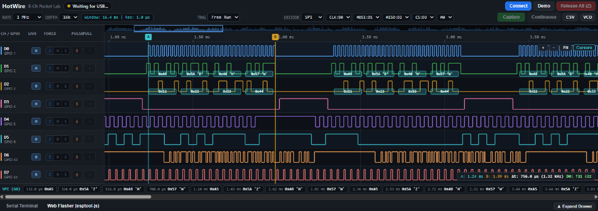

# HotWire Logic Analyzer — 8-Channel Pocket Lab & Tri-State Force I/O

[](https://github.com/kavierim/HotWire-Logic-Analyzer/actions/workflows/deploy.yml)
[](https://kavierim.github.io/HotWire-Logic-Analyzer/)
[](https://www.seeedstudio.com/XIAO-ESP32S3-p-5627.html)
[](https://developer.mozilla.org/en-US/docs/Web/API/Web_Serial_API)
[](https://leptos.dev/)

A zero-install **Progressive Web App (PWA)** paired with **Seeed Studio XIAO ESP32-S3 / ESP32-C6** firmware (`HotWire_XIAO_ESP32.ino`) providing an **8-channel digital logic analyzer (`D0`–`D7`, up to 20 MHz / 32,768 samples)**, **25 Hz live pin telemetry**, and **glitch-free tri-state forcing (`Z` / `0` / `1` + Pull-Up/Pull-Down + 20 ms short-circuit auto-cutoff)** over a single multiplexed USB CDC stream.

> **Try it in 1 click (no hardware required):** Open **[https://kavierim.github.io/HotWire-Logic-Analyzer/](https://kavierim.github.io/HotWire-Logic-Analyzer/)** and click **Demo** to explore live captures, pin forcing, and UART/SPI/I²C protocol decoding.



## Features

* **Dual-Platform USB Connectivity (`SerialTransport`):**
  * **Desktop Chrome / Edge:** **Web Serial API** (`115200`, `DTR=true, RTS=true`) with automatic zero-touch hot-plug reconnection.
  * **Android Chrome / Tablets:** **WebUSB API** targeting CDC-ACM / Espressif (`0x303A`) / Seeed (`0x2886`) interfaces with explicit `SET_CONTROL_LINE_STATE` (`0x22`, `value: 0x0003`) control transfer.
  * **Offline Simulator (`Demo`):** Interactive XIAO ESP32-S3 protocol simulator with waveforms, pin forcing, and simulated short-circuit protection.
* **8-Channel Pin Mapping (XIAO ESP32-S3):**
  * `CH0`–`CH5`: `D0`–`D5` -> `GPIO 1`–`6`
  * `CH6`–`CH7`: `D6`–`D7` -> `GPIO 43`–`44`
  * Internal USB pins (`GPIO 19`, `GPIO 20`) are never touched.
* **Hardware-Verified 20 MHz Dual-Core Firmware:**
  * **Core 0:** Non-blocking binary + UTF-8 command parser, `25 Hz` change-driven `0x81` telemetry, and `20 ms` bus contention auto-cutoff watchdog.
  * **Core 1:** Dedicated `LA_Capture_Core1` task (`configMAX_PRIORITIES - 1`) using single-cycle Dedicated GPIO (`ee.get_gpio_in`) for deterministic `100 kHz`–`20 MHz` bursts and `esp_timer_get_time()` for abortable `1 kHz`–`50 kHz` captures, with `0%`/`25%`/`50%` pre-trigger circular buffer linearization.
* **Single-Screen Dark UI & Tools:**
  * Sticky 8-row Tri-State Force strip (`[ Z ] [ 0 ] [ 1 ]`, momentary `[ ⚡ ]` pulse, `[ - | PU | PD ]` pull control, flashing `SHORT!` fault indicator, and red `[ Release All (Z) ]` button).
  * High-DPI interactive `<canvas>` waveform viewer aligned 1:1 with the 8 channel rows, featuring dynamic time ruler, trigger marker, zoom/pan/touch-pinch, and draggable `A`/`B` measurement cursors ($\Delta t$ and $1/\Delta t$).
  * Collapsible bottom **Web Flasher** drawer (`0xF0` auto-reboot to ROM bootloader + bundled `.bin` flashing for XIAO ESP32-S3 & ESP32-C6).

## Arduino IDE Firmware Build Settings

Open [HotWire_XIAO_ESP32.ino](./firmware/HotWire_XIAO_ESP32/HotWire_XIAO_ESP32.ino) in Arduino IDE (or `arduino-cli`) with Espressif ESP32 Core (`v2.0.14+` or `v3.x`):

* **XIAO ESP32-S3:** Board `XIAO_ESP32S3` (`esp32:esp32:XIAO_ESP32S3`), `USB CDC On Boot: Enabled`, `CPU Frequency: 240MHz (WiFi)`
* **XIAO ESP32-C6:** Board `XIAO_ESP32C6` (`esp32:esp32:XIAO_ESP32C6`), `USB CDC On Boot: Enabled`, `CPU Frequency: 160MHz (WiFi)`

## HotWire Ecosystem

* **[HotWire Logic Analyzer](https://github.com/kavierim/HotWire-Logic-Analyzer)** ([Live App](https://kavierim.github.io/HotWire-Logic-Analyzer/)) — 8-Channel Logic Analyzer & Tri-State Force I/O with UART/SPI/I²C decoders
* **[HotWire Oscilloscope](https://github.com/kavierim/HotWire-Oscilloscope)** ([Live App](https://kavierim.github.io/HotWire-Oscilloscope/)) — 4-Channel 12-bit GDMA ADC Oscilloscope & FFT Spectrum Analyzer
* **[HotWire SDR](https://github.com/kavierim/HotWire-SDR)** ([Live App](https://kavierim.github.io/HotWire-SDR/)) — 1.84–2.79 GHz RF Spectrum Analyzer, Wideband Scanner & Waterfall for XIAO ESP32-S3 & XIAO ESP32-C6
* **[HotWire Serial Terminal](https://github.com/kavierim/HotWire-Serial-Terminal)** ([Live App](https://kavierim.github.io/HotWire-Serial-Terminal/)) — Cross-platform Web Serial & WebUSB terminal for desktop and Android

## Development

Built with **Rust + WebAssembly** ([Leptos](https://leptos.dev/) CSR + [Trunk](https://trunkrs.dev/)).

```bash
rustup target add wasm32-unknown-unknown
cargo clippy --all-targets -- -D warnings
cargo test
trunk serve          # local dev server (http://127.0.0.1:8081)
trunk build --release
```

## License

Copyright © 2026 Kari Vierimaa, Kempele — Licensed under the [Apache License 2.0](LICENSE).
